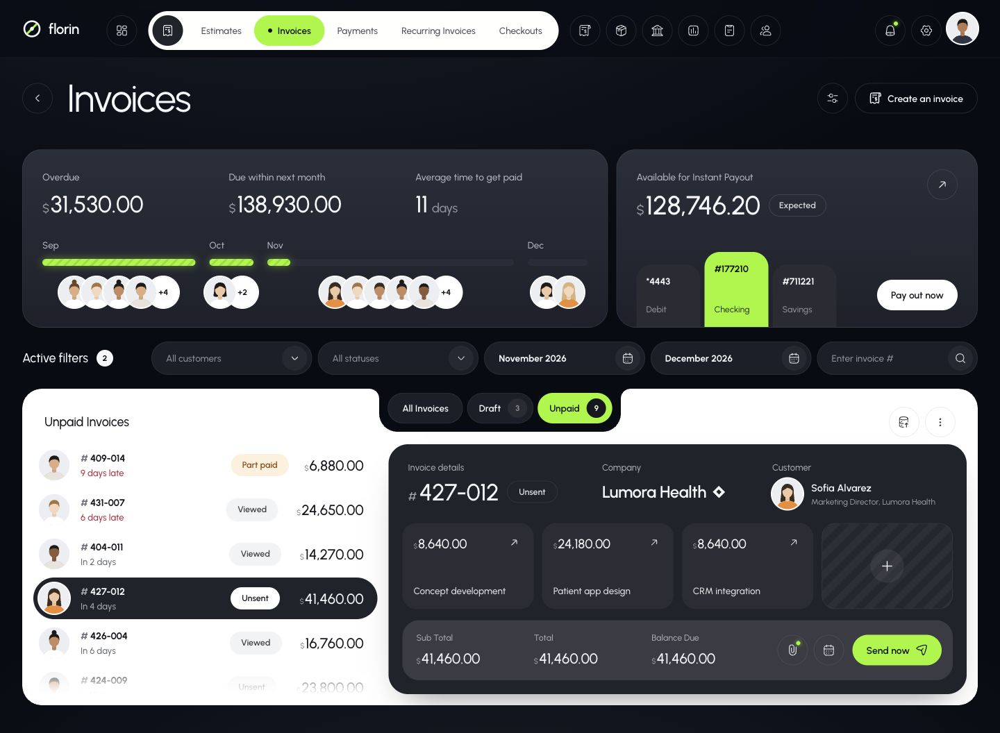
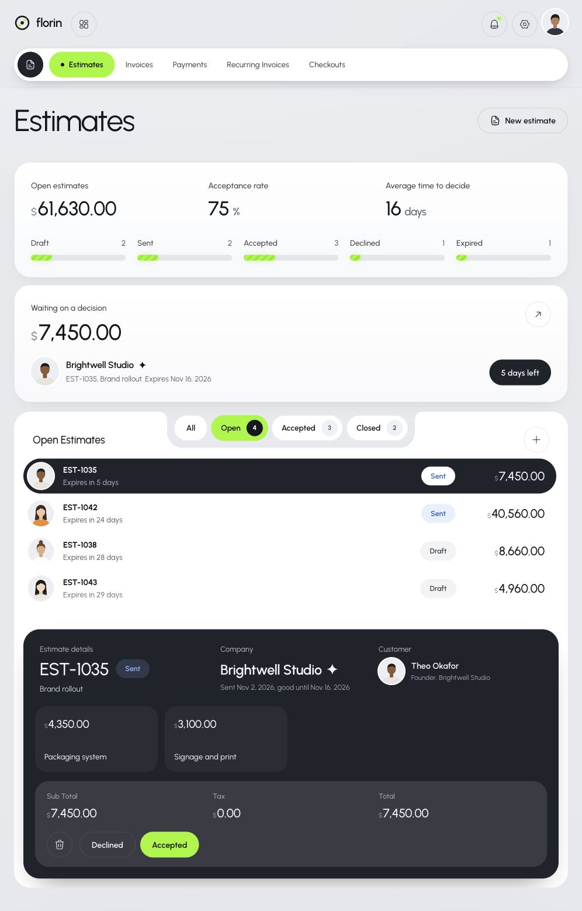

# Florin reference board

Source: https://ui.cortexcn.dev/previews/florin/estimates/
Captured 11 November 2026. Third-party demo data, not Luma records.
The owner selected all page patterns, colours, fonts, radii and both modes.

Each named page has light/dark JPG captures and a structure text file.
Pages: invoices, estimates, payments, recurring, checkouts, new (invoice editor),
products, payouts, reports, activity, customers, customer, settings.
`invoices-desktop-dark.jpg` and `invoices-mobile-dark.jpg` show responsive layout.
`tokens-light.json` and `tokens-dark.json` are computed CSS reference values.
Use fully rendered captures; page-loading captures are not design evidence.

See [the active contract](../../luma-design-system/README.md). Preserve these
screenshots as reference, not customer-facing artwork. No PDF updates.
